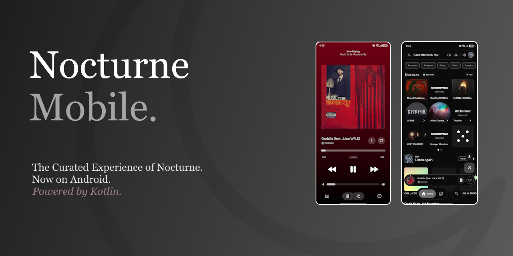

<div align="center">



# Nocturne Mobile

**A native Android YouTube Music client — built for Nocturne, designed for music on the go.**

<p align="center">
  
  
  
  
</p>

**Nocturne Mobile** is a native Android music client built as the mobile counterpart to [Nocturne Desktop](https://github.com/Neo-XD/nocturne-music), while also working completely independently.

Stream and manage your music, take your library with you, sync seamlessly with your PC, and enjoy a refined Nocturne experience designed specifically for Android.

</div>

---

## Features

* **Native Android UI**: Built from the ground up in modern Jetpack Compose.
* **Ad-Free Playback**: Direct streaming from YouTube Music without video audio ads.
* **Background Audio & Gapless**: Keeps playing smoothly when screen is locked or in the background.
* **Explore & Instant Search**: Search songs, albums, artists, and playlists with query history chips.
* **Nocturne Sync**: Pair with Nocturne Desktop on your local network to synchronize now-playing status, queue, and playback control with built-in rate-limiting.
* **You Tab**: Dedicated personal hub featuring listening minutes stats, recent history, downloads, Last.fm scrobbler preview, and quick access.
* **Synced Lyrics**: Time-synced lyrics with translation and glowing typography.
* **Offline Downloads**: High quality local track downloads with embedded metadata and artwork.
* **Wear OS Companion**: Dedicated remote control app for Wear OS 3+ watches.
* **Part of the Nocturne Ecosystem**: Seamlessly companion to [Nocturne Desktop](https://github.com/Neo-XD/nocturne-music).

---

<h2 align="center">Download</h2>

<p align="center">
  <a href="https://github.com/Neo-XD/nocturne-mobile/releases/latest">
    
  </a>
</p>

Download the latest release APK from the [Releases](https://github.com/Neo-XD/nocturne-mobile/releases/latest) page and install it on your Android device.

---

## Part of the Nocturne Ecosystem

Nocturne Mobile was built alongside **[Nocturne Desktop](https://github.com/Neo-XD/nocturne-music)**, the desktop version of Nocturne available for Windows, macOS, and Linux.

The applications share the same goal:

> A fast, native, customizable YouTube Music experience without the bloat of **Electron**.

| Platform | Project | Description |
| -------- | ------- | ----------- |
| Desktop | [Nocturne Desktop](https://github.com/Neo-XD/nocturne-music) | The Original Client. Built for Windows, macOS, and Linux. |
| Android | Nocturne Mobile | The Mobile Client. Built for Android and as a companion app to the original. |

---

## Building from Source

Clone the repository:

```bash
git clone https://github.com/Neo-XD/nocturne-mobile.git
cd nocturne-mobile
```

Build using Gradle:

```bash
./gradlew assembleDevDebug
```

### Last.fm & Sync Credentials

To enable Last.fm scrobbling and custom sync party servers in local builds, supply them in `local.properties`:

```properties
LASTFM_API_KEY=your_key
LASTFM_SECRET=your_secret
LISTEN_TOGETHER_SERVER=https://your-server.com
```

---

## Disclaimer

This project is not affiliated with, funded, authorized, endorsed by, or in any way associated with YouTube, Google LLC, or any of their affiliates and subsidiaries.

All trademarks, service marks, and intellectual property rights referenced in this project belong to their respective owners.

---

## License

[GPL-3.0](LICENSE)
